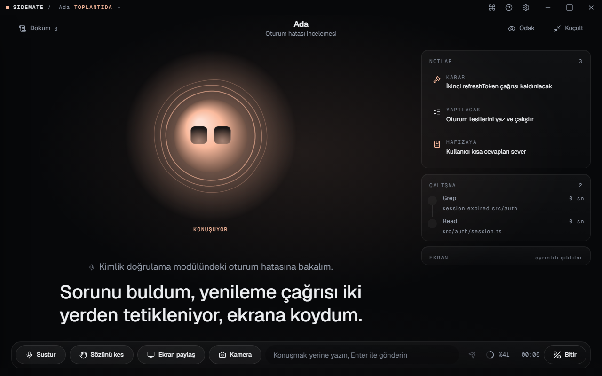
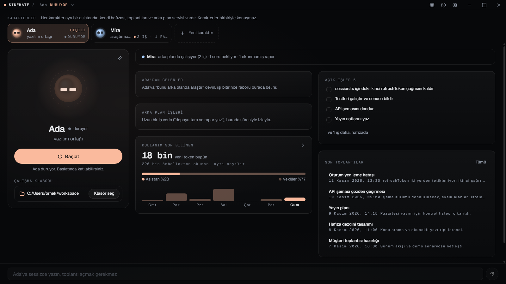
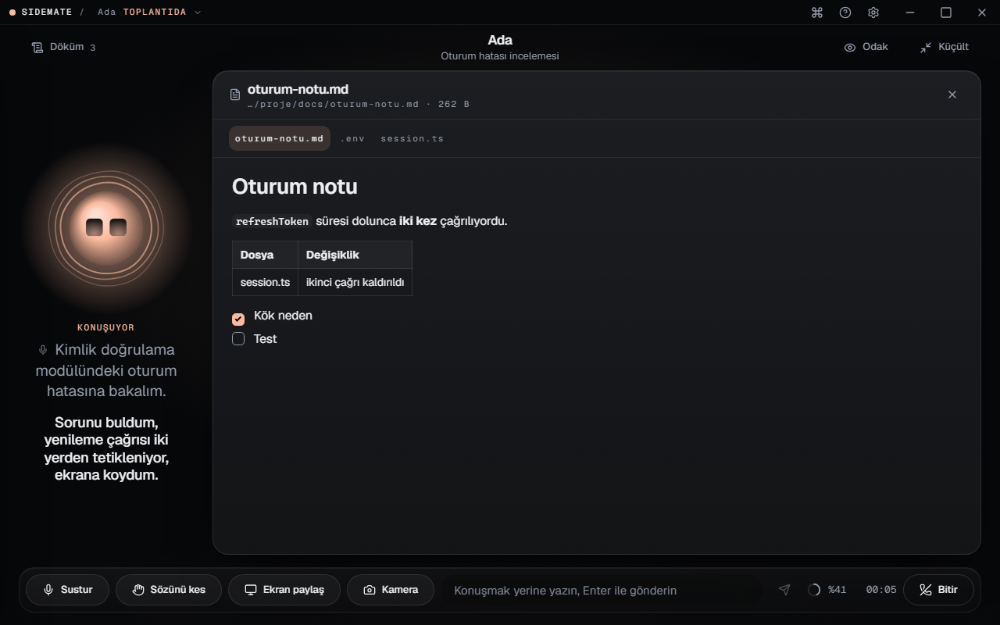
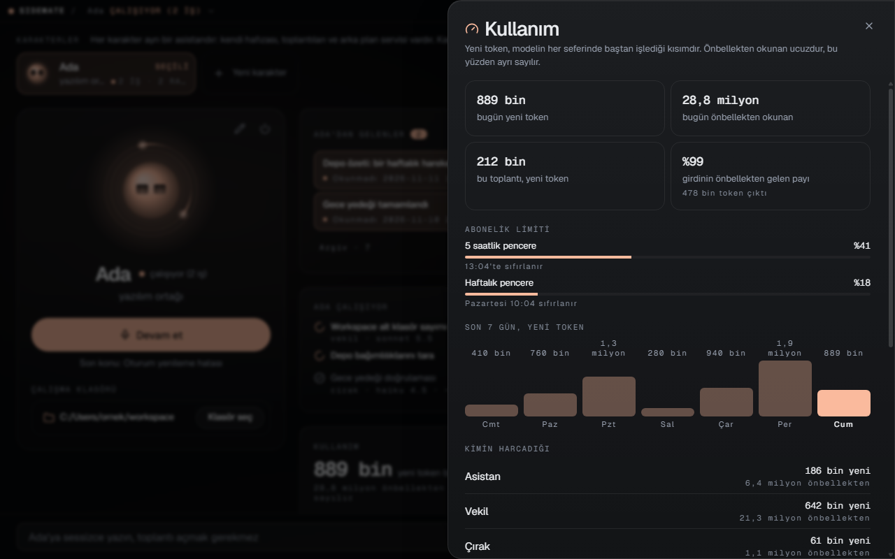
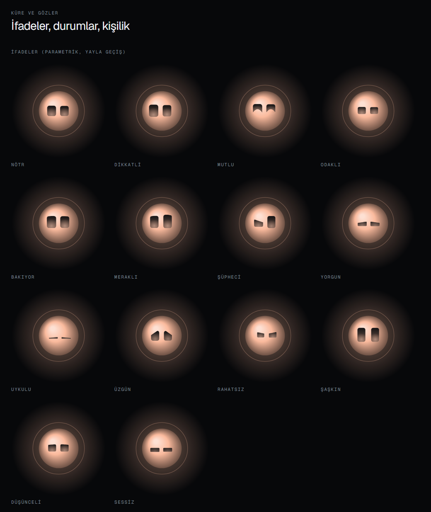

# SideMate

**Masaüstünüzde konuşan çalışma arkadaşı.**
**A voice-first work companion for your desktop.**

[Türkçe](#türkçe) · [English](#english)

---

## Türkçe

SideMate, bilgisayarınızda yanınızda duran sesli bir çalışma arkadaşıdır. Ona konuşarak iş verirsiniz; dinler, düşünür, sesli yanıt verir ve uzun işleri arka planda sizin yerinize yürütür. Kendi adı, kişiliği ve hafızası olan birden fazla karakter oluşturabilirsiniz.

SideMate **ücretsizdir**. Kapalı kaynaklı bir uygulamadır; kullanım koşulları [SideMate Ücretsiz Kullanım Lisansı](docs/EULA.tr.md) içindedir.

### Neler yapar

- **Sesli toplantı:** Konuşarak anlatın, araya girip sözünü kesin. Kararlar, yapılacaklar ve hafızaya alınanlar toplantı boyunca not edilir.
- **Arka plan işleri:** "Bunu araştır ve rapor yaz" deyin; iş arka planda sürerken konuşmaya devam edin. Biten işin raporu gelen kutusuna düşer.
- **Dosya önizleme:** Yazdığı ya da açtığı dosyayı yanında gösterir; Markdown, tablo ve işaret kutuları okunaklı biçimde açılır.
- **Hafıza:** Tercihlerinizi, açık işleri ve geçmiş toplantıları hatırlar; bir sonraki konuşma kaldığı yerden başlar.
- **Ekran ve kamera:** İsterseniz ekranınızı ya da kameranızı paylaşın, gördüğü üzerinden konuşun.
- **Canlı yüz:** Dinlerken, düşünürken ve konuşurken ifadesi değişen gözler.
- **Kullanım takibi:** Günlük kullanımı ve abonelik pencerelerinizi tek bakışta görün.
- **Kendiliğinden güncelleme:** Yeni sürüm çıktığında sorar ve tek tıkla kurar.

### İndir

| Sistem | Dosya |
|---|---|
| Windows 10 / 11 (64 bit) | [SideMate Windows kurulumu (.exe)](https://github.com/sagentiq/sidemate-releases/releases/latest) |
| macOS 11 ve üzeri (Apple Silicon: M1 ve sonrası) | [SideMate Mac disk görüntüsü (.dmg)](https://github.com/sagentiq/sidemate-releases/releases/latest) |

Sayfadaki **Assets** bölümünde `x64-setup.exe` Windows için, `aarch64.dmg` Mac içindir.

### Kurulum

**Windows**
1. `SideMate_<sürüm>_x64-setup.exe` dosyasını indirip çalıştırın.
2. "Windows bilgisayarınızı korudu" uyarısı çıkarsa **Ek bilgi**, ardından **Yine de çalıştır** seçin. Uygulama henüz kod imzalı olmadığı için bu uyarı beklenen bir durumdur.
3. SideMate açılır ve ilk kurulum sihirbazı gereken parçaları sizin için hazırlar.

**Mac**
1. `SideMate_<sürüm>_aarch64.dmg` dosyasını açın ve **SideMate**'i Uygulamalar klasörüne sürükleyin.
2. İlk açılışta macOS "geliştirici doğrulanamadı" diyebilir. **Sistem Ayarları > Gizlilik ve Güvenlik** sayfasının altındaki **Yine de Aç** düğmesine basın. Eski sürümlerde uygulamaya sağ tıklayıp **Aç** demek de yeterlidir.
3. Mikrofon, kamera ve ekran kaydı izinleri ilk kullanımda sorulur. Ekran kaydı iznini verdikten sonra uygulamayı yeniden başlatın.

### Gereksinimler

- Etkin bir Claude aboneliği ve bilgisayarınızda giriş yapılmış **Claude Code**. Kurulum sihirbazı bunu denetler ve eksikse yol gösterir.
- Mikrofon. Kulaklık önerilir.
- İlk kurulumda ses modelleri için birkaç GB boş alan ve internet bağlantısı.

### Lisans

SideMate'i ücretsiz kullanabilirsiniz. Kurulum sihirbazı lisans metnini gösterir ve onayınızı ister; metne uygulamadaki **Hakkında** sayfasından da ulaşırsınız. Yazılım kapalı kaynaklıdır: kopyalanamaz, değiştirilemez, yeniden dağıtılamaz. Tam metin: [Türkçe](docs/EULA.tr.md).

### Gizlilik

Ses tanıma ve seslendirme bilgisayarınızda çalışır. Konuşmalarınız, hafıza ve toplantı kayıtları yalnız kendi bilgisayarınızda saklanır. Asistanın düşünmesi için gereken istekler, kendi Claude hesabınız üzerinden gider.

---

## English

SideMate is a voice-first work companion that lives on your desktop. You give it work by talking; it listens, thinks, answers out loud, and runs longer tasks in the background for you. You can create several characters, each with its own name, personality and memory.

SideMate is **free to use**. It is a closed-source application; the terms are in the [SideMate Free Use License](docs/EULA.en.md).

### What it does

- **Voice meetings:** Talk naturally and interrupt at any time. Decisions, to-dos and things to remember are noted as you go.
- **Background work:** Say "research this and write a report", keep talking while it runs, and find the report in your inbox when it is done.
- **File preview:** Files it writes or opens appear right beside the conversation, with readable Markdown, tables and checklists.
- **Memory:** It remembers your preferences, open items and past meetings, so the next conversation picks up where you left off.
- **Screen and camera:** Share your screen or camera when you want it to see what you see.
- **A living face:** Eyes that react while it listens, thinks and speaks.
- **Usage at a glance:** Daily usage and your subscription windows in one card.
- **Automatic updates:** It asks when a new version is out and installs it in one click.

### Download

| System | File |
|---|---|
| Windows 10 / 11 (64-bit) | [SideMate installer for Windows (.exe)](https://github.com/sagentiq/sidemate-releases/releases/latest) |
| macOS 11 or later (Apple Silicon: M1 and later) | [SideMate disk image for Mac (.dmg)](https://github.com/sagentiq/sidemate-releases/releases/latest) |

In the **Assets** section, `x64-setup.exe` is for Windows and `aarch64.dmg` is for Mac.

### Installation

**Windows**
1. Download and run `SideMate_<version>_x64-setup.exe`.
2. If Windows shows "Windows protected your PC", choose **More info**, then **Run anyway**. The app is not code-signed yet, so this warning is expected.
3. SideMate opens and the first-run setup prepares everything it needs.

**Mac**
1. Open `SideMate_<version>_aarch64.dmg` and drag **SideMate** into Applications.
2. On first launch macOS may say the developer cannot be verified. Go to **System Settings > Privacy & Security** and click **Open Anyway**. On older versions, right-click the app and choose **Open**.
3. Microphone, camera and screen recording permissions are requested on first use. Restart the app after granting screen recording.

### Requirements

- An active Claude subscription and **Claude Code** signed in on your computer. The setup checks this and guides you if anything is missing.
- A microphone. Headphones are recommended.
- A few GB of free space and an internet connection for the voice models during first setup.

### License

SideMate is free to use. The setup wizard shows the license and asks for your acceptance; you can also read it on the **About** page in the app. The software is closed source: it may not be copied, modified or redistributed. Full text: [English](docs/EULA.en.md).

### Privacy

Speech recognition and voice synthesis run on your computer. Conversations, memory and meeting notes are stored only on your machine. Requests the assistant needs for thinking go through your own Claude account.

---

## Ekran görüntüleri · Screenshots

<table>
  <tr>
    <td width="50%"> <b>Ana ekran:</b> karakterler, gelen kutusu, açık işler. <b>Home:</b> characters, inbox, open items.</td>
    <td width="50%"> <b>Dosya önizleme</b> toplantının içinde. <b>File preview</b> inside a meeting.</td>
  </tr>
  <tr>
    <td width="50%"> <b>Kullanım:</b> günlük tüketim ve abonelik pencereleri. <b>Usage:</b> daily totals and subscription windows.</td>
    <td width="50%"> <b>İfadeler:</b> dinlerken, düşünürken, konuşurken. <b>Expressions:</b> listening, thinking, speaking.</td>
  </tr>
</table>

---

Kurulum dosyaları ve güncelleme bildirimi bu depoda yayınlanır. · Installers and the update feed are published from this repository. 
© 2026 SAGENTIQ LTD. Tüm hakları saklıdır. · All rights reserved.

